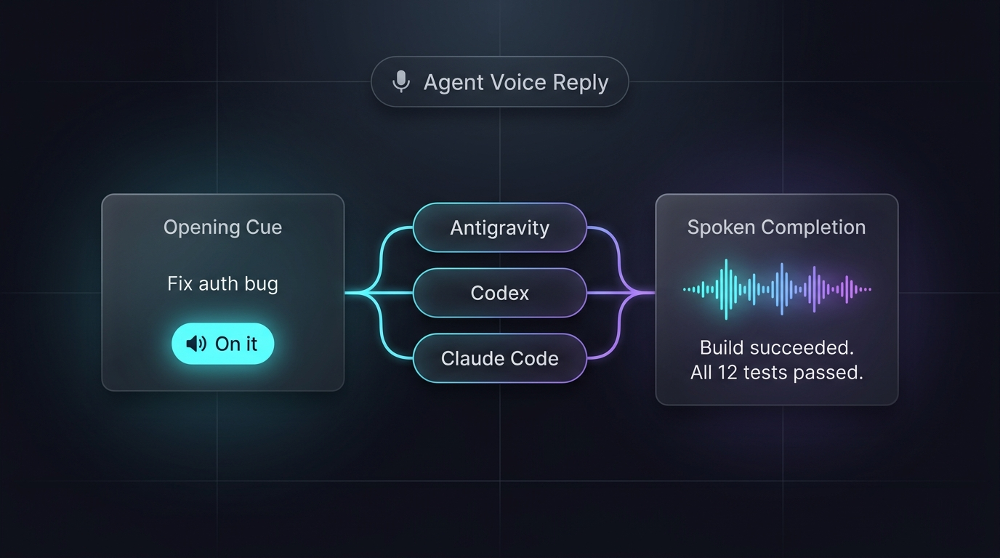

# Agent Voice Reply

[English](./README.md) | 中文

## 项目简介

Agent Voice Reply 是一款专为 AI 编码助手打造的双向语音反馈工具。它让 Antigravity、Codex 和 Claude Code 在执行任务时具备自然的听觉反馈：用户提交任务时立即应声确认，任务执行结束时用口语化简短语句播报结果与待决策事项，彻底解放双眼，告别对着终端或 IDE 干等。

## 效果预览


双向语音交互：发送任务时即时应声，任务完成时决策优先语音播报。

## 核心功能

| 能力 | 它能帮你做什么 |
|---|---|
| 即时开场提示 | 发送任务瞬间立即发声回应（“好，这就做”、“我看看”），离线缓存零延迟。 |
| 决策优先播报 | 任务完成时优先朗读需要用户拍板的选择或确认事项，把单向通知变成双向协作。 |
| 多客户端原生兼容 | 原生支持 Antigravity、Codex 和 Claude Code，统一配置与音色。 |
| 自动中英文适配 | 自动识别每条消息与回复的语言，或按配置锁定特定中/英文音色。 |
| 子 Agent 静音隔离 | 严格识别主交互与子任务，多 Agent 并行或内部工具调用时保持绝对静默。 |

## 安装

### 配置要求

开始使用前仅需准备基础 Node 与 Python 环境，首次安装时 Agent 会协助检查与补齐。

| 项目 | 要求 |
|---|---|
| Agent 客户端 | Antigravity、Codex 或 Claude Code（已原生验证） |
| 基础环境 | Node.js ≥ 18、Python ≥ 3.9 |
| 音频播放支持 | macOS 原生自带 `afplay`，Linux/Windows 支持 `ffplay`/`mpv`/`mpg123` |
| 语音合成引擎 | Edge TTS（自动安装于本地专属虚拟环境，需访问微软端点） |

### 快速安装

打开你正在使用的 Agent 客户端，发送以下指令完成自动安装与环境注册：

```text
帮我安装这个 Skill：https://github.com/chemny/agent-voice-reply
先检查基础环境，缺什么帮我补齐，再安装并检查能不能用。其他功能等我需要时再配置。
```

安装完成后，Agent 会自动注册生命周期 Hook 并执行 `doctor.mjs` 测试发声。

## 快速开始

在支持的客户端中正常下发任何日常编码或提问任务即可自动触发：

```text
帮我排查一下当前目录下的测试用例是否有失败项
```

客户端在接收到回车时会立即语音应答，完成排查后会自动口头播报测试结论。

## 使用示例

### 决策确认场景

```text
帮我重构用户认证模块，涉及破坏性数据库迁移
```

任务执行完成时，Agent 会通过语音优先播报待确认动作：“改好了，需要你确认是否立即执行数据库迁移？”。

### 多 Agent 协同场景

```text
启动两个子 Agent 分别调研方案 A 和方案 B 的性能差异并汇总
```

子任务调研期间自动静音，待主 Agent 汇总完成时统一口头播报对比结论。

## 工作原理

项目通过轻量生命周期 Hook（Lifecycle Hooks）接管任务起止节点，结合本地预缓存与 Edge TTS 实现零延迟响应：

| 组件 | 对应脚本/配置 | 它负责什么 |
|---|---|---|
| Antigravity 适配器 | `scripts/antigravity-hook.mjs` | 监听 `PreInvocation` 触发开场，监听 `Stop` 提取语音标记并播报 |
| Codex 适配器 | `scripts/codex-hook.mjs` | 监听 `UserPromptSubmit` 与 `Stop`，处理 Codex 桌面与终端事件 |
| Claude Code 适配器 | `scripts/claude-hook.mjs` | 接入 Claude Code 会话生命周期，提取回复语音标记 |
| 核心开场引擎 | `scripts/opening.mjs` | 意图分类（提问/指令/兜底）、语种识别与高频离线 mp3 缓存管理 |
| 语音合成与播放 | `scripts/speak.mjs` | Edge TTS 调度、并发播放互斥锁与跨平台播放器调用 |
| 全局自检排障器 | `scripts/doctor.mjs` | 全链路诊断运行时、依赖、音色、缓存及三端 Hook 注册状态 |

## 目录结构

```text
agent-voice-reply/
├── assets/
│   └── workflow-overview.png  # 产品交互与架构示意图
├── scripts/
│   ├── antigravity-hook.mjs   # Antigravity 生命周期钩子适配器
│   ├── codex-hook.mjs         # Codex 生命周期钩子适配器
│   ├── claude-hook.mjs        # Claude Code 生命周期钩子适配器
│   ├── speak.mjs              # 核心语音合成与跨平台音频播放
│   ├── opening.mjs            # 开场分类规则与多语言处理
│   ├── manage-hooks.mjs       # 三端 Hook 幂等注册与管理
│   └── doctor.mjs             # 全链路环境与发声诊断脚本
├── adapters/                  # OpenClaw 与 Hermes 实验性适配器
├── SKILL.md                   # Agent Skill 规范定义文件
├── setup.sh                   # 一键初始化配置脚本
├── test.sh                    # 自动化回归测试套件
└── LICENSE                    # 开源协议
```

## 许可

本项目采用 Apache 2.0 许可证开源。详情见 [LICENSE](./LICENSE)。

## 关于我

Neo Chen ([@chemny](https://github.com/chemny)) — 关注 AI Agent、开发者效率工具与智能体工作流实践。欢迎在 GitHub 提交 Issue 或 PR 交流讨论。
